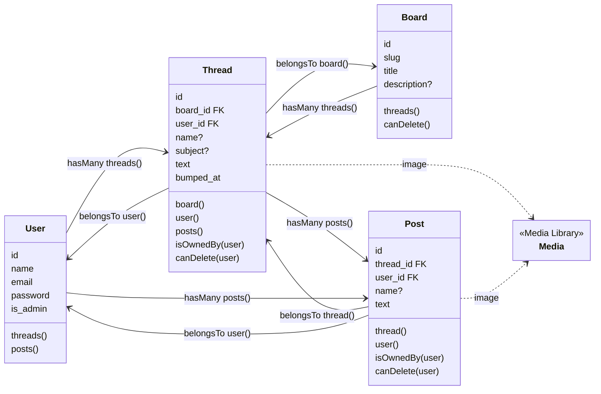
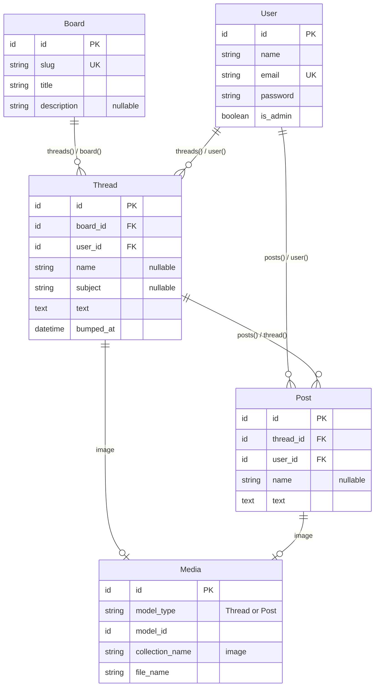

# Spacechan

## Imageboard for Harbour Space

An imageboard is an online forum where images are central to posts, often alongside text and discussion. ([Wikipedia, “Imageboard”](https://en.wikipedia.org/wiki/Imageboard))

## what it does

- browse boards, threads, and replies
- create threads and replies with optional images; login required to post
- delete your own threads and replies
- admins manage boards and edit threads and replies
- replies bump threads to the top



Each class lists its columns, then its methods: the relationships and the business rules. `?` marks an optional column and `FK` a foreign key. Timestamps are left out. `Media` stands for Media Library's own table: a thread or a post can have one optional image.

<details>
<summary>Database tables (ER diagram)</summary>



Each line is one relationship, labelled with its `hasMany` and `belongsTo` methods. `Media` is Media Library's table: it points to a thread or a post through `model_type` and `model_id` (a polymorphic relationship), and the `image` collection holds at most one image. Timestamps are left out.

</details>

## Run

```sh
composer run setup
php artisan migrate:fresh --seed
composer run dev
```

Open [http://localhost:8000](http://localhost:8000).

Seeded accounts, both with the password `password`:

- Admin: `Admin` — `admin@example.com`
- Test: `Test User` — `test@example.com`

## next additions

- guest posting
- poster ids per thread
- sage replies and bump limits
