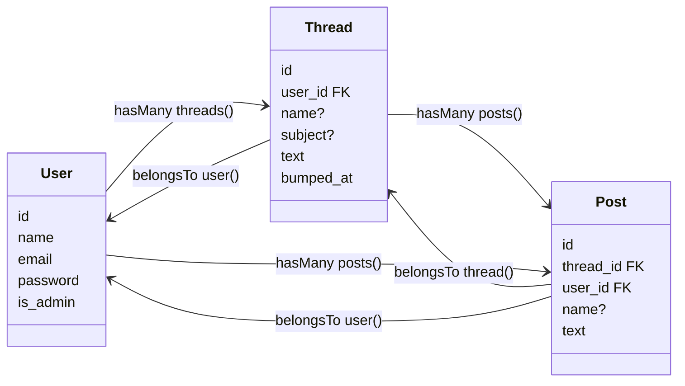

# spacechan: first version

Brainstormed 2026-11-25. Not planned or built yet.

## What it is

A 4chan-style imageboard for Harbour Space students, which might be hosted on the school LAN one day. It's also the MWA1 course project.

This covers only the first version: the smallest core that works and is easy to build on. It doesn't try to meet the course requirements yet. Later steps add those.

## Goals

- A working board where you can start a thread, reply, and delete your own posts.
- It feels like an imageboard: posts show as anonymous, and replying moves a thread to the top (bump order).
- Every line is easy to explain to the teacher.
- Later steps add to the data model without redoing it.

## Not in the first version

Images, boards, an admin zone, editing, guest posting, poster IDs, sage and bump limits. These are listed under "Later steps".

## To avoid

- Clever code, or features that make the project harder to explain.
- Unused code that only exists for a future feature.

## Who can do what

- Anyone can read.
- Posting needs an account, using the starter pack's login and register pages.
- A thread or reply can be deleted by its owner or by an admin.
- Nobody can edit.

## Data model

```
User    name, email, password, is_admin
Thread  user_id, name, subject, text, bumped_at   ← the opening post
Post    thread_id, user_id, name, text            ← a reply
```



`?` marks a column that can be empty and `FK` is a foreign key. The `created_at` and `updated_at` timestamps are left out.

Relationships, all one-to-many:

- A User has many threads, and a Thread belongs to a user.
- A User has many posts, and a Post belongs to a user.
- A Thread has many posts, and a Post belongs to a thread.

Columns:

- `users.name` is the account name, and the board never shows it. `name` on threads and posts is an optional display name. If it's empty, the post shows "Anonymous".
- `subject` is optional and `text` is required.
- `bumped_at` is set when the thread is created and again whenever someone replies.
- Deleting a thread deletes its replies, using `cascadeOnDelete()` on `posts.thread_id`.

## Pages

| Page | Who can see it |
|---|---|
| Front page: threads in bump order (`latest('bumped_at')`) | everyone |
| Thread page: opening post, replies from oldest to newest, reply form when logged in | everyone |
| New thread form | logged in |
| Delete a thread or a reply | the owner or an admin |

Following the course's zones, reading pages are public and writing pages are in the user zone. URLs are plain: `/threads/142`.

## "(You)" and the delete button

Your own posts show "(You)" and a delete button.

- One model method, `isOwnedBy(?User $user): bool`, decides "(You)".
- The delete rule is "owned by you, or you're an admin", and it builds on `isOwnedBy()`.

Keeping "is this mine?" in one method matters for guest posting later (see below).

## The choices we made, and why

### How anonymous it is

1. **Log in to post, and everyone shows as Anonymous.** Every post has an owner, and only admins can see who it is.
2. **Like 1, plus an optional name per post, as with 4chan's name box. This is the one we picked.**
3. **Guests can post without an account.** This is the most like 4chan, but posts can have no owner, guests can't delete their own posts, and it invites spam. We left it for later.

We chose 2 because the course needs accounts: it requires login, owners set from `auth()->id()`, and rules about who can do what. Showing Anonymous on the page keeps the imageboard feel.

**Switching to 3 later** is small: one migration that makes `user_id` nullable, and moving the "new post" route out of the `auth` group. The trap is that a guest's `auth()->id()` is `null` and a guest post's `user_id` is also `null`. A plain `$post->user_id === auth()->id()` check would then say every guest owns every guest post. With `isOwnedBy()` as the only ownership check, the fix is in one place.

### Where the opening post lives

- **(a) On `Thread` itself. This is the one we picked.**
  - The front page lists threads directly, with no extra query to find each thread's first post.
  - Deleting the opening post means deleting the thread, which is how 4chan works.
  - It has the same shape as the course demo (an article with comments).
  - The cost is that `name` and `text` appear on both tables.
- **(b) As the first `Post`.** Every post would have the same shape, but:
  - the front page needs extra work to load each thread's first post without an N+1 query
  - creating a thread saves two records
  - deleting the first post needs its own rule

### Boards and URLs

- The first version has no boards: everything is one global board.
- Nobody has links to keep, because the app is reinstalled with `migrate:fresh --seed`. Views link with named routes, so URLs can change freely later.
- When boards arrive, URLs become `/boards/g/threads/142`, which `Route::resource('boards.threads', ...)` generates on its own.
- We chose that over 4chan's `/g/thread/142` because a top-level `/{board}` would match `/login`, `/register` and every other page. Avoiding that takes hand-written routes, careful route order, and a list of forbidden board names.
- **Still undecided:** whether thread URLs are shallow (`/threads/142`) or fully nested (`/boards/g/threads/142`).
  - Shallow needs a little less code.
  - Fully nested needs two parameters in every link, `with('board')` on any page that lists threads from more than one board, and `->scoped()` so a thread can't be shown under the wrong board.
  - Either way, reply URLs stay short (`/threads/142/posts`, `/posts/7`).

### Editing

Users never edit, as on imageboards. Admins will be able to edit for moderation once the admin zone exists. That also covers the course's full CRUD requirement, since it accepts the admin zone.

### Images

The first version is text only.

- Media Library keeps images in its own `media` table, so adding images later needs no migration on `threads` or `posts`.
- We add no `HasMedia` code until uploads exist, so no code sits unused.
- Images are optional, so a post without one is simply a text post and no fallback picture is needed. A fallback would only make sense if every opening post had to have an image and the front page became a grid of thumbnails. In Media Library that's one line, `useFallbackUrl()`.

### Thread order

Bump order is in the first version: the thread with the newest reply goes to the top. It costs one column (`bumped_at`), one line in the code that saves a reply, and one `latest('bumped_at')`. Inside a thread, replies stay oldest first.

## Later steps

In the order I'd guess:

1. **Images**, with Media Library.
   - Maybe require an image on opening posts, as 4chan does. The front page could then become a grid of thumbnails, with a fallback picture (`useFallbackUrl()`) for threads without one, such as seeded threads.
2. **Boards**: a `Board` model (`slug`, `title`, `description`) and `board_id` on `threads`. Admins create boards.
3. **The admin zone**: moderation (including seeing who wrote each post), editing, and full CRUD for boards.
4. **The rest**:
   - poster IDs: a short code from the user and the thread, worked out when the page is shown, so you can follow one person within a thread but not across threads
   - guest posting
   - sage: a reply that doesn't bump
   - a bump limit: after a set number of replies, new replies stop bumping

## Calls I made that you can override

- **Deleting your account deletes your threads and posts** (`cascadeOnDelete()` on `user_id`). Without this, the starter pack's "delete account" button would fail for anyone who has posted.
- **The new thread form** lives in the user zone, following the course's zone rules.

## Open

- Shallow or fully nested thread URLs, once boards exist.
